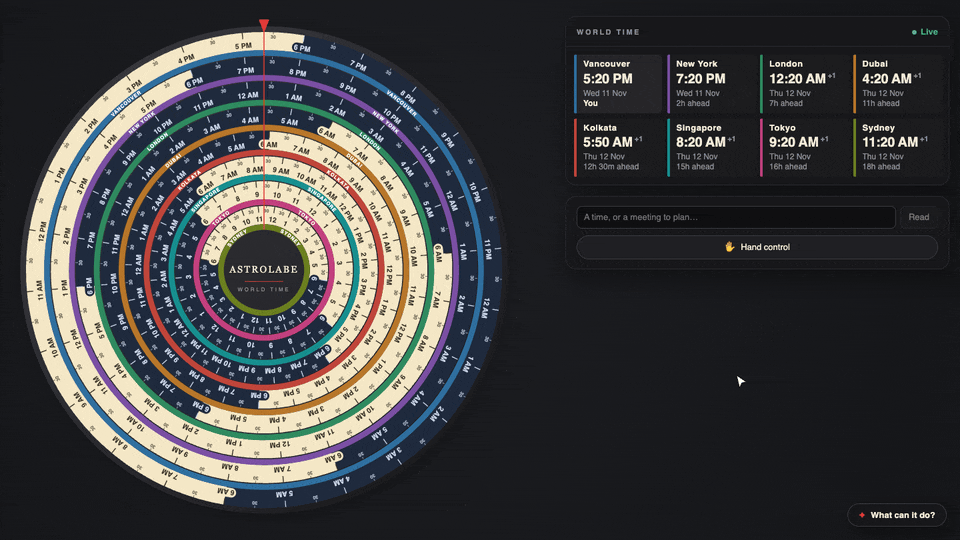

<p align="center">
  
</p>

<h1 align="center">Astrolabe</h1>

<p align="center"><b>One dial, eight cities, every time zone at a glance.</b></p>

<p align="center">
  
</p>

Astrolabe is a world clock built as a set of rotating rings. Each ring is a city turned to its own local time, so reading straight down the red line at the top gives you the time everywhere at once. On top of that it has three AI features: turn the dial with your hand through the webcam, drop in a screenshot to jump to the times inside it, and ask for a meeting slot across cities in plain English.

It's plain HTML, CSS and JavaScript with no framework and no build step, plus a tiny Python server for the AI.

> 💻 Astrolabe is designed for laptops and desktops. On phones, tablets and narrow windows it shows a short message instead.

---

## ✨ Features

### 🕰️ Read every city at a glance
Eight concentric rings (Vancouver, New York, London, Dubai, Kolkata, Singapore, Tokyo and Sydney), each rotated to its local time. Light sections are daytime, dark sections are night. The **World time** card beside the dial lists the same times in words, with the date and how far ahead or behind each city is.

### ✋ Turn the dial with your hand · *AI, on-device*
Switch on the camera, then **pinch** your thumb and index finger to grab the dial, **twist** your hand to move through time, and **let go** to leave it there. Hand tracking runs entirely in the browser, so no video ever leaves your computer.

### 📸 Drop anything with a time in it · *AI*
Drag in a screenshot of a meeting invite, flight confirmation or chat message, paste one with ⌘V, drop a text or calendar (`.ics`) file, or just type *"standup at 9:30 IST tomorrow"*. AI reads the dates, times and time zones, and the dial turns to each one it finds. A preview of what you dropped appears in the tools card, and you can step through several times with ‹ › or the ← → keys.

### 🤝 Find a meeting time across cities · *AI*
Ask for something like *"a one-hour call with New York and London next week"*. Astrolabe finds the first slot when everyone, including you, is within working hours (9 AM to 5 PM on a weekday). The cities taking part light up with their working hours on the dial, the others fade back, and a red wedge marks the window when everyone is free. If no slot fits, it picks the one that asks the least of everyone and shows who would be outside their working hours.

### 🧭 Built-in guide
The **✦ What can it do?** button in the bottom-right corner lists every feature, with a button to try each one on the spot.

---

## 🚀 Run it locally

You need **Python 3.9 or newer** (already installed on macOS and most Linux systems) and a modern desktop browser such as Chrome, Edge, Safari or Firefox. Nothing to `pip install` or `npm install`.

```bash
# 1. Get the code
git clone https://github.com/utsavk1993/astrolabe.git
cd astrolabe

# 2. Add your free NVIDIA API key (only needed for the AI reading and meeting features)
cp .env.example .env
# then open .env and paste your key after NVIDIA_API_KEY=

# 3. Start the server
python3 server.py

# 4. Open the app
open http://localhost:8000      # or paste the address into your browser
```

### 🔑 Getting a free NVIDIA API key
1. Go to [build.nvidia.com](https://build.nvidia.com) and sign in (free).
2. Open any model page and choose **Get API Key**.
3. Paste the key (it starts with `nvapi-`) into `.env`.

The key stays on your machine: `.env` is listed in `.gitignore`, and the server only listens on `localhost`.

### 🧩 What works without a key
The dial, the World time card and hand control all work without a key. Only reading dropped screenshots and text, and the meeting finder, need the server and a key.

### ⚙️ Optional settings (`.env`)

| Setting | What it does |
|---|---|
| `NVIDIA_API_KEY` | Your key from build.nvidia.com. Required for the AI features. |
| `NVIDIA_MODEL` | Use a different vision model from NVIDIA's catalogue. |
| `NVIDIA_THINKING=1` | Lets the model reason before answering. Slightly more careful, but around 45 seconds per request instead of a few seconds. |
| `PORT` | Serve on a different port (default `8000`). |
| `HOST` | Address to listen on. Default `127.0.0.1` (only your machine); use `0.0.0.0` on a cloud host. |
| `RATE_PER_MINUTE` | AI requests one visitor can make per minute (default `6`). |
| `RATE_PER_DAY` | AI requests one visitor can make per day (default `40`). |
| `DAILY_CAP` | AI requests for all visitors together per day (default `500`). |
| `MAX_CONCURRENT` | AI requests handled at the same time (default `3`). |
| `TRUST_PROXY` | Set to `1` behind a cloud load balancer so each visitor is identified by their real address. |
| `ALLOWED_ORIGINS` | Comma-separated sites allowed to use the AI endpoint, e.g. `https://astrolabe.example.com`. Default: only the site itself. |

---

## 🛠️ Tech stack

| Layer | Technology | Used for |
|---|---|---|
| 🧱 Structure and logic | **HTML, CSS, vanilla JavaScript** | The whole interface. No framework, no bundler, no build step. |
| 🎨 Graphics | **SVG** | The dial: rings, labels, working-hour arcs and the overlap wedge. |
| 🌍 Time zones | **`Intl.DateTimeFormat`** and the browser's built-in **IANA time zone database** | Local times, daylight saving, offsets and formatting for every city. |
| ✋ Hand tracking | **Google MediaPipe Tasks Vision, Hand Landmarker** (WebAssembly + GPU) | Finding 21 points on your hand in every camera frame, in the browser. |
| 📷 Camera | **`getUserMedia`** (WebRTC) | Webcam access for hand control. |
| 〰️ Smoothing | **One Euro filter** | Removing hand jitter without adding lag. |
| 🧠 Language and vision AI | **NVIDIA Nemotron 3.5 Super VL** via the **NVIDIA API catalogue** (free tier, OpenAI-compatible API) | Reading times from screenshots and text, and understanding meeting requests. |
| 🐍 Backend | **Python 3 standard library** (`http.server`, `urllib`) | Serving the site and passing requests to NVIDIA while keeping the key secret. |
| 🖼️ Image prep | **Canvas API** | Shrinking screenshots before upload. |
| 💬 Pop-up | **HTML `<dialog>`** | The "What can it do?" guide, with built-in focus handling and Esc to close. |

---

## 🔍 How it works

### 🕰️ The dial
Each ring is drawn once as an SVG circle with 24 hours around it. To show a city's time, the whole ring is simply **rotated** so the current hour sits under the red line at the top. One full turn is 24 hours, so an hour is 15 degrees. The browser's time zone database gives the exact local time for each city, including daylight saving, so every ring is always correct relative to the others.

The dial redraws **once per second**, not 60 times a second. The rings only move 15 degrees an hour, so anything more would waste battery for no visible difference.

### ⏩ Moving through time
The dial can show any moment, not just now. Instead of jumping, it **glides** to the new time with an easing curve. When the jump is more than half a day, it skips whole days instantly first, because the rings look the same every 24 hours. Jumping a week ahead therefore doesn't spin the dial seven times.

While the dial is moving, the small :30 marks fade out. Many fine marks on concentric rings moving together create a spiralling optical illusion; fading them keeps the motion calm.

### ✋ Hand control
1. **Finding the hand.** Google's MediaPipe Hand Landmarker, a small machine-learning model, runs in the browser on your graphics chip. For every camera frame it returns 21 points: the wrist, each knuckle and each fingertip.
2. **Detecting a pinch.** A pinch counts only when the thumb and index fingertips are close together in 3D, the index finger is extended, and at least two other fingers are open. It must also hold for a short moment. These rules stop a fist, or just a turned hand, from grabbing the dial by accident.
3. **Measuring the twist.** The angle of a line from the wrist to the middle of the knuckles gives the hand's rotation. Turning your hand changes that angle, and the change becomes time: twisting further moves the dial further.
4. **Keeping it steady.** Raw hand positions shake slightly. A **One Euro filter** smooths small jitter while still following fast, deliberate movement. The dial also snaps to **5-minute steps**, with a little resistance at each one, so it settles cleanly instead of trembling.
5. **Letting go.** Opening the pinch releases the dial where it is. A short delay ignores the tiny movement your hand makes while releasing.

### 📸 Reading times from screenshots and text
1. The browser shrinks the image and sends it, or the text, to the local Python server.
2. The server forwards it to **NVIDIA's Nemotron vision-language model** with instructions to reply only with structured JSON: a short label, the date and time exactly as written, and the time zone.
3. The AI only *reads*. All the time zone maths happens in the browser: it converts "10:00 AM in Los Angeles on Thursday" into an exact moment, handling daylight saving, and turns the dial to it.
4. Common abbreviations like PT, ET, IST and JST are also mapped to time zones in code, as a safety net in case the model guesses wrong.

The server turns off the model's step-by-step "thinking" mode, which brings typical replies down from about 45 seconds to a few seconds (the free tier is sometimes slower when it's busy). Busy errors from NVIDIA's free tier are retried automatically.

### 🤝 Finding a meeting slot
The AI's only job is to **understand the request**: which cities, which day to start from, and how long the meeting is. Everything after that is ordinary code:

1. Your own time zone is added to the list of cities.
2. The next 7 days are checked in 15-minute steps. At each step every city gets a score: 0 inside 9 AM–5 PM on a weekday, 1 for a slightly long day (8 AM–7 PM), 2 for early morning or evening, and 4 for night or a weekend.
3. The first stretch long enough for the meeting where everyone scores 0 wins. If there isn't one, the slightly-long-day hours are allowed. If even that fails, it picks the slot with the lowest total score and shows who would be outside their working hours.
4. On the dial, the cities taking part show their working hours as green arcs and the rest fade back. Because each ring is rotated to its own time, the arcs line up exactly where everyone is free. The red wedge marks that overlap.

Splitting the work this way keeps the AI's part small and easy to check, and makes the scheduling itself exact and repeatable.

### 🐍 Why there's a server at all
Browsers block web pages from calling NVIDIA's API directly, and an API key placed in page code would be visible to anyone. The small Python server solves both problems: the page talks to `localhost`, and the server adds the key and forwards the request. It serves only the site's own files (never `.env`), and only accepts connections from your own machine.

---

## 📁 Project structure

```
astrolabe/
├── index.html          Page structure: dial, World time card, tools card, guide pop-up
├── styles.css          All styling, the three-column layout and the small-screen message
├── clock.js            The dial: drawing, time zone maths, gliding, the World time card
├── hands.js            Hand control: camera, MediaPipe, pinch detection, smoothing
├── drop.js             Dropping, pasting and typing: previews, reading, stepping through times
├── meeting.js          Meeting finder: slot search and the meeting card
├── tour.js             The "What can it do?" pop-up
├── server.py           Local server and the bridge to NVIDIA's API
├── sample-invite.png   Sample screenshot used by the guide
├── assets/demo.gif     The demo at the top of this README
├── favicon.svg         A miniature of the dial
└── .env.example        Template for your API key
```

---

## 🎨 Customizing

- **Change the cities:** edit the `ZONES` list at the top of `clock.js`. Each entry is a name, an IANA time zone (for example `Europe/Berlin`) and a colour. Around eight rings is the practical limit before the inner labels run out of room.
- **Change working hours:** edit `WORK` and `STRETCH` at the top of `meeting.js`, and `WORK_START` / `WORK_END` in `clock.js` for the arcs on the dial.

---

## 🌐 Deploying

`server.py` runs as-is on any host that can run a Python process, such as **Render**, **Railway** or **Fly.io**. There's nothing to install.

1. Create a web service from this repository with the start command `python3 server.py`.
2. Add these environment variables in the host's dashboard (never commit them):
   - `NVIDIA_API_KEY`: your key
   - `HOST=0.0.0.0`
   - `TRUST_PROXY=1`
3. The host provides `PORT` automatically.

A purely static host such as GitHub Pages can serve the dial and hand control, but not the AI features, because those need the server to keep the key secret.

---

## 🛡️ Protecting the free API quota

A public demo with a free API key needs guard rails, or one visitor (or one script) could use up the whole quota. The server has four built in, all adjustable in the settings above:

1. **⏱️ Per-visitor limits.** Each visitor gets 6 AI requests a minute and 40 a day. Past that they see a friendly "please wait" message, and the response includes a `Retry-After` header.
2. **📊 A shared daily cap.** At most 500 AI requests a day across everyone. That's a hard ceiling on what the demo can spend, whatever happens.
3. **🚦 A concurrency limit.** At most 3 requests are sent to the AI at once; extra ones are asked to retry in a few seconds.
4. **🌍 An origin check.** Browsers label every request with the site it came from. The server only answers its own site, so other websites can't quietly build on your key.

Only requests that actually reach the AI are counted, and the limits are kept in memory, which suits a single server. If the demo ever gets popular, the next steps would be:
- an invisible bot check such as **Cloudflare Turnstile** in front of the AI features;
- a shared store such as **Redis** for the counters, so several servers agree on them;
- **caching** the sample requests, so the guide's demo buttons don't use the quota at all.

---

## 🔒 Privacy

- 📷 Camera frames are processed **only in your browser** and are never uploaded.
- 📸 Screenshots and text you drop or type are sent to **NVIDIA's API** to be read, through your local server. Don't drop anything you wouldn't want to share with a third-party service.
- 🔑 Your API key stays in `.env` on your machine.

---

## 🤝 Contributing

Issues and pull requests are welcome. There is no build step: edit a file, refresh the browser, and you'll see the change.

---

## 📄 License

[MIT](LICENSE). Free to use, modify and share.
